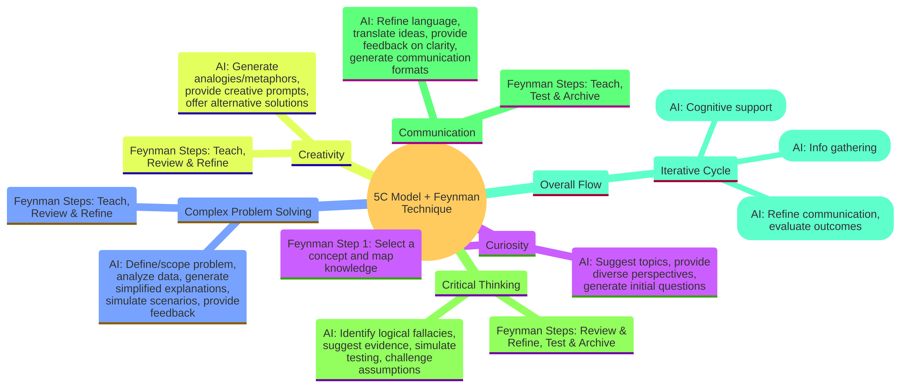

# 5C Framework – Overview

**Integrated Learning & Problem‑Solving Framework**

Combines the **5C Model** (Curiosity, Complex Problem Solving, Creativity, Critical Thinking, Communication) with the **Feynman Technique**, enhanced by AI tools for accelerated learning and effective problem resolution.

### The 5C Model
- **Curiosity** – The initial spark and exploration  
- **Complex Problem Solving** – Core analysis  
- **Creativity** – Innovation and ideation  
- **Critical Thinking** – Evaluation and refinement  
- **Communication** – Articulation and validation

### The Feynman Technique
A proven 4‑step method for deep understanding through simplification:
1. **Select a concept and map your knowledge**  
2. **Teach it to a 12‑year‑old**  
3. **Review and Refine**  
4. **Test and Archive**
